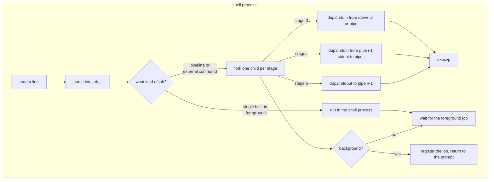
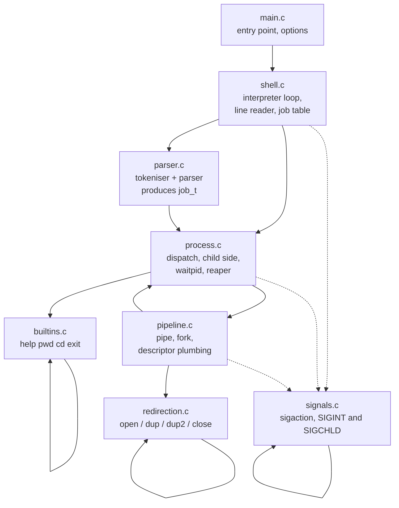
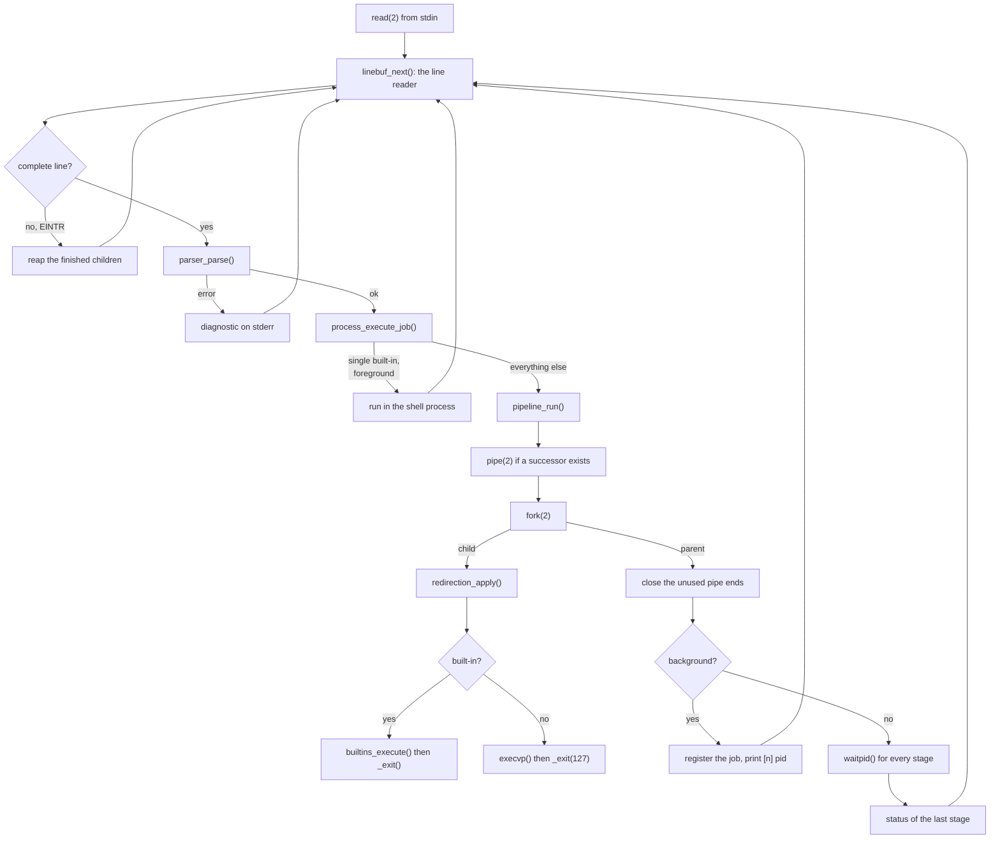

# Building a Mini Unix Shell with Process System Calls

**A case study in process creation, redirection, pipelines and signal handling**

| Field | Value |
|---|---|
| Project | `minishell` - a Unix shell written from scratch in C11 |
| Version | 1.0.0 |
| Language | C11 (`-std=c11`), POSIX.1-2008 interfaces only |
| Toolchain | GCC 13.3.0, GNU Make 4.3 |
| Verification environment | Ubuntu 24.04.5 LTS user space, kernel `6.6.87.2-microsoft-standard-WSL2` |
| Source size | 1719 lines of C in 8 modules, 268 lines of headers |
| Test suite | 7 test programs, 173 assertions, 0 failures |
| Experiments | 7 experiments (A-G), all executed, transcripts in `results/` |

---

## Table of contents

1. [Abstract](#1-abstract)
2. [Introduction and motivation](#2-introduction-and-motivation)
3. [Problem statement](#3-problem-statement)
4. [Objectives and scope](#4-objectives-and-scope)
5. [Background: how a Unix shell works](#5-background-how-a-unix-shell-works)
6. [Relevant system calls](#6-relevant-system-calls)
7. [Design goals and principles](#7-design-goals-and-principles)
8. [System architecture](#8-system-architecture)
9. [Component design](#9-component-design)
10. [Command language and grammar](#10-command-language-and-grammar)
11. [Process creation and program execution](#11-process-creation-and-program-execution)
12. [File descriptor management and redirection](#12-file-descriptor-management-and-redirection)
13. [Pipelines](#13-pipelines)
14. [Background jobs and the job table](#14-background-jobs-and-the-job-table)
15. [Signal handling](#15-signal-handling)
16. [Built-in commands](#16-built-in-commands)
17. [Error handling and exit status](#17-error-handling-and-exit-status)
18. [Memory and resource management](#18-memory-and-resource-management)
19. [Testing methodology](#19-testing-methodology)
20. [Test results](#20-test-results)
21. [Experimental design](#21-experimental-design)
22. [Experimental results](#22-experimental-results)
23. [Observations on performance](#23-observations-on-performance)
24. [Security considerations](#24-security-considerations)
25. [Limitations and future work](#25-limitations-and-future-work)
26. [Verification status and platform compatibility](#26-verification-status-and-platform-compatibility)
27. [Conclusion and references](#27-conclusion-and-references)

Appendix A: [Test traceability matrix](#appendix-a-test-traceability-matrix)
Appendix B: [System call mapping](#appendix-b-system-call-mapping)
Appendix C: [Repository layout](#appendix-c-repository-layout)

---

## 1. Abstract

This project implements a Unix command interpreter, `minishell`, from scratch
in C11.  The shell reads a command line from a terminal or from standard
input, parses it according to an explicitly documented grammar, and executes
it by combining POSIX process interfaces: `fork(2)`, `execvp(3)`,
`waitpid(2)`, `pipe(2)`, `dup2(2)`, `open(2)`, `close(2)` and `sigaction(2)`.

The purpose of the exercise is pedagogical rather than practical.  The
implementation exists to make the process model of Unix observable: a shell
is a small program whose entire job is to create other programs and to
connect them with pipes and file descriptors.  Every design decision is
therefore justified by the behaviour of the underlying system calls rather
than by convenience.

The project delivers four built-in commands (`help`, `pwd`, `cd`, `exit`),
support for quoting and escaping, input redirection (`<`), output redirection
(`>` and `>>`), pipelines (`|`) and background execution (`&`).  Syntax that
is outside the documented grammar - variable expansion, command substitution,
globbing, here-documents, command separators - is rejected with a
diagnostic rather than silently ignored, so the shell never executes
something different from what the user typed.

Correctness is demonstrated by 173 assertions in seven test programs (a
unit test for the parser and six integration test scripts that drive the
real executable), all of which pass, including a complete re-run under
AddressSanitizer and UndefinedBehaviorSanitizer with leak detection
enabled.  Seven experiments with `strace(1)`, `ps(1)` and wall-clock
measurement provide direct evidence for the claims made about process
creation, foreground and background execution, descriptor plumbing, pipeline
behaviour, error reporting and resource hygiene; their transcripts are
stored in `results/`.

The verification status is stated explicitly: the project was developed on
Windows and is executed on Linux.  All measurements were taken in an
Ubuntu 24.04 container on the WSL2 kernel.  Kali Linux was **not** used for
verification, and no claim of native Windows execution is made.

---

## 2. Introduction and motivation

The Unix shell is the oldest and still the most widely used user interface
of the operating system.  It is also the shortest and most complete
description of what a Unix process model does: the shell reads a string,
decides which programs to start, starts them, and connects them to each
other and to the file system.

Most users meet the shell through a prompt and never see the mechanism
behind it.  Reading a shell's source code is nevertheless the fastest way
to understand what `fork()`, `exec()` and `wait()` are for, and why a
pipeline is a kernel object rather than a library construct.

This project builds such a shell from first principles.  The constraints
were chosen so that the result is small enough to be understood completely
and yet exercises the interesting parts of the process model:

* **No `system()`.**  `system(3)` hides the entire mechanism behind a
  single library call.  The implementation therefore uses `fork(2)` and
  `execvp(3)` explicitly, which is what makes the system calls observable
  in the traces of Experiment A.
* **POSIX only.**  No Windows API is used and no Windows-specific
  behaviour is emulated, so the code is portable to any conforming POSIX
  system.
* **An explicit grammar.**  The accepted language is documented in
  `docs/parser_grammar.md` and everything outside it is rejected.  A shell
  that guesses what the user meant would defeat the purpose of the
  exercise.
* **Measured evidence.**  Every behavioural claim in this report is either
  backed by a test assertion or by a stored trace.  Where something has
  not been verified, it is marked as such.

---

## 3. Problem statement

Given a line of text, a Unix shell must decide:

1. how to split the line into words, honouring quoting and escaping;
2. how to group the words into commands, pipelines and jobs;
3. which of those commands are implemented inside the shell itself and
   which are external programs;
4. how to create a process for each external program;
5. how to arrange the file descriptors so that each program reads what it
   should read and writes what it should write;
6. how to connect the stages of a pipeline;
7. when to wait for a child and when not to;
8. what to do when a system call fails, when a program cannot be found, or
   when the user interrupts the shell.

The problem is not the individual steps - each of them is a short sequence
of system calls - but their *interaction*.  The subtle parts are:

* the buffer of the parent process is inherited by the child, so a child
  that exits with `exit(3)` may write the parent's pending output a second
  time;
* a pipe that is still open in the parent never reports end-of-file to the
  reader, which deadlocks the pipeline;
* `SIGCHLD` may arrive at any instruction boundary, so it cannot be used
  to do work that is not async-signal-safe;
* a built-in that must change the state of the shell cannot be executed in
  a child process.

The project demonstrates that each of these problems has a solution that
can be implemented in a few dozen lines, and that the solution can be
verified.

---

## 4. Objectives and scope

### 4.1 Objectives

| # | Objective | Where it is demonstrated |
|---|-----------|---------------------------|
| O1 | Implement a working command interpreter in C11 using only POSIX process interfaces | `src/`, `make run` |
| O2 | Implement a documented grammar with quoting, escaping, redirection, pipelines and background execution | `docs/parser_grammar.md`, `tests/test_parser.c` |
| O3 | Implement four built-in commands that can change shell state | `src/builtins.c`, `tests/test_builtins.sh` |
| O4 | Demonstrate the process lifecycle with system call traces | Experiment A, `results/process_creation.txt` |
| O5 | Distinguish foreground and background execution measurably | Experiments B and C, `results/foreground_background.txt` |
| O6 | Demonstrate descriptor plumbing for redirection and pipelines | Experiments D and E, `results/syscall_trace.txt`, `results/pipeline_experiment.txt` |
| O7 | Verify that the shell survives every class of failure | Experiment F, `results/error_handling.txt` |
| O8 | Verify that no zombie process and no file descriptor is leaked | Experiment G, `results/resource_management.txt` |
| O9 | Provide an automated, deterministic test suite with a sanitizer variant | `tests/`, `make test`, `make sanitize-test` |
| O10 | Document the design, the system calls, the limits and the verification status honestly | `docs/` |

### 4.2 Scope

**In scope:** the command language listed in section 10, the process
lifecycle, redirection, pipelines, background jobs, the four built-ins,
error reporting, exit status conventions, resource hygiene.

**Out of scope, and deliberately rejected by the parser:** variable
expansion, command substitution, pattern matching (globbing), here-documents,
the command separator `;`, subshells and grouping, job control (process
groups, `fg`, `bg`, `jobs`, `kill %1`), aliases, functions, and a
configurable prompt.  Section 25 discusses why, and what each omission
would cost to implement.

---

## 5. Background: how a Unix shell works

### 5.1 The classical sequence

The traditional way to start an external program is three system calls:

```
parent                          child
------                          -----
fork()  ------------------->    (copy of the parent's address space)
                                execvp("ls", argv)  --> new program image
waitpid(pid, &status, 0) <---  exit(status)
```

`fork(2)` duplicates the process.  Both processes continue from the same
instruction, so the return value of `fork(2)` is what distinguishes them.
The child then replaces its program image with `execvp(3)`, which searches
`PATH` if the command name contains no slash.  The parent blocks in
`waitpid(2)` until the child terminates and receives the exit status.

The separation of `fork(2)` and `exec(2)` is what makes a shell possible.
Between the two calls the child may do anything it likes - change the
working directory, install signal handlers, open and close descriptors,
redirect the standard streams - and all of it happens before the new
program starts.

### 5.2 Why a shell is a fork-and-exec loop

Once the sequence above is understood, a shell is largely determined:

* a **built-in** is a command the shell implements itself, because it must
  change shell state (`cd`) or terminate the shell (`exit`);
* an **external command** is started with the sequence above;
* a **pipeline** is a sequence of external commands whose standard output
  is connected to the standard input of the next one;
* a **redirection** replaces a standard stream with an open file;
* a **background job** is a job for which the shell does not wait.

### 5.3 The process model in one diagram



---

## 6. Relevant system calls

The implementation uses the following interfaces.  The mapping from the
POSIX name to the Linux system call that glibc actually issues is given in
the appendix; it matters because the traces in `results/` show the Linux
names.

| Interface | Purpose in this project | Where |
|---|---|---|
| `fork(2)` | create a child process for a command or a pipeline stage | `src/pipeline.c` |
| `execvp(3)` | replace the child's image with the requested program; searches `PATH` | `src/process.c` |
| `_exit(2)` | terminate a child without flushing the inherited stdio buffers | `src/process.c` |
| `waitpid(2)` | block for a specific child; `waitpid(-1, WNOHANG)` reaps all finished children | `src/process.c` |
| `pipe(2)` | create the kernel buffer that connects two pipeline stages | `src/pipeline.c` |
| `open(2)` | open the target of `<`, `>` or `>>` | `src/redirection.c` |
| `dup(2)` | save the current descriptor 0 or 1 so it can be restored | `src/redirection.c` |
| `dup2(2)` | install a descriptor on position 0 or 1 atomically | `src/redirection.c`, `src/pipeline.c` |
| `close(2)` | release a descriptor; the mechanism that makes a pipe report end-of-file | `src/redirection.c`, `src/pipeline.c` |
| `read(2)` | read the command line; survives `EINTR` without losing data | `src/shell.c` |
| `write(2)` | used by `printf` through the C library | `src/builtins.c` |
| `sigaction(2)` | install the `SIGINT` and `SIGCHLD` handlers | `src/signals.c` |
| `sigprocmask(2)` | block `SIGINT` around `fork(2)` so it cannot arrive in the child by accident | `src/signals.c` |
| `chdir(2)` | implement `cd` | `src/builtins.c` |
| `getcwd(3)` | implement `pwd` | `src/builtins.c` |
| `getenv(3)` | find `$HOME` for `cd` without arguments | `src/builtins.c` |
| `isatty(3)` | decide whether the prompt should be printed | `src/shell.c` |

No call to `system(3)` appears anywhere in the source tree, and no call to
`access(2)` either: the distinction between "command not found" and
"command found but not executable" is derived from the `errno` value that
`execvp(3)` leaves behind (see section 11.4), not from a separate
existence check.  A separate check would be racy, because the file could
change between the check and the execution.

---

## 7. Design goals and principles

1. **Show the mechanism.**  Every stage of the process lifecycle is
   implemented explicitly with the POSIX interface, never through a
   convenience wrapper that would hide it.
2. **One module, one responsibility.**  The parser knows nothing about
   processes, the process module knows nothing about the grammar, and the
   signal module knows nothing about either.
3. **Explicit state, passed explicitly.**  The only mutable state shared
   between modules is the `shell_state_t` structure, which is passed by
   pointer.  There is no hidden global state, which is what makes the
   modules testable in isolation.
4. **Fail loudly, never guess.**  Unsupported syntax is rejected with a
   diagnostic.  A command is never executed in a way the user did not
   write.
5. **Correctness under failure.**  Every allocation is checked, every
   `fork(2)` failure is handled, and every descriptor that is opened is
   closed.
6. **Honest documentation.**  The report distinguishes what was measured
   from what was reasoned about, and section 26 states the verification
   status of each platform explicitly.

---

## 8. System architecture

### 8.1 Module map



| File | Responsibility | Lines |
|---|---|---|
| `src/main.c` | Entry point, option handling, installation of the signal handlers | 46 |
| `src/shell.c` | Interpreter loop, `read(2)` line reader, background job table | 293 |
| `src/parser.c` | Tokeniser and parser; produces the `job_t` data structure | 609 |
| `src/builtins.c` | The four built-in commands | 184 |
| `src/process.c` | Job dispatch, child side of the fork, `waitpid(2)`, the reaper | 182 |
| `src/pipeline.c` | Construction of pipelines, descriptor plumbing, background jobs | 189 |
| `src/redirection.c` | `open(2)` / `dup(2)` / `dup2(2)` / `close(2)` for `<`, `>` and `>>` | 99 |
| `src/signals.c` | `sigaction(2)` setup and the signal-safe flag mechanism | 117 |

### 8.2 Data flow



### 8.3 The interpreter loop

`shell_run()` in `src/shell.c` performs the following steps in every
iteration:

1. `process_reap_children()` collects the background jobs that have
   terminated and prints the `Done` notification for them.
2. The prompt is printed **only** when standard input is a terminal
   (`isatty(3)`) and only when the user has not started to type a line.
   A scripted run therefore produces output without prompt characters.
3. `linebuf_next()` reads one line with `read(2)`.
   * `EINTR` is not an error: a partially typed line is kept and the read
     continues; if nothing was typed yet the loop is simply restarted.
   * end of file ends the loop.
4. A blank line is ignored.
5. `parser_parse()` converts the line into a `job_t`.  A parse error
   produces a diagnostic and the loop continues.
6. `process_execute_job()` executes the job and returns its exit status.
7. The status is stored in `state->last_status` and the loop continues.

The shell terminates when the `exit` built-in is executed, or when standard
input reaches end of file.  In the latter case the status of the last
command becomes the status of the shell, which is the behaviour of a POSIX
shell.

### 8.4 Why `read(2)` and not `getline(3)`

`getline(3)` cannot be resumed reliably when it is interrupted by a
signal: the bytes that have already been read may be lost.  The small
reader in `src/shell.c` keeps the bytes that were read before the
interruption and simply continues, and it also knows whether a partial line
is pending.  The latter allows the shell to redraw the prompt after a
background job has finished without destroying what the user has already
typed.

---

## 9. Component design

### 9.1 Parser (`src/parser.c`, 609 lines)

The largest module, because the tokeniser is the part of a shell that is
most often implemented sloppily.  It is split into two phases:

* **the tokeniser** scans a raw line and produces a vector of tokens,
  each with a type (`WORD`, `PIPE`, `REDIR_IN`, `REDIR_OUT`, `REDIR_APPEND`,
  `AMP`) and, for a `WORD`, the dequoted text;
* **the parser** consumes the token vector and builds the `job_t`.

The dequoting is done by the tokeniser because the rules depend on the
context: a backslash escapes a double quote inside `"..."`, a single quote
cannot be escaped inside `'...'`, and quoted and unquoted text may be
adjacent and still form one word.

Every token owns its text, and `job_free()` releases the whole tree.  An
earlier revision of this module freed the token text twice; the defect was
found by the unit test and is described in section 19.4.

### 9.2 Process module (`src/process.c`, 182 lines)

Contains four responsibilities: the decision *where* a command runs, the
child side of the fork, the translation of a `waitpid(2)` status into an
exit code, and the reaper.

### 9.3 Pipeline module (`src/pipeline.c`, 189 lines)

Contains the descriptor bookkeeping, which is the delicate part of the
project; it is described in section 13.

### 9.4 Redirection module (`src/redirection.c`, 99 lines)

Encapsulates the `open` / `dup` / `dup2` / `close` sequence and, crucially,
knows how to undo it, which is what makes it usable for a built-in that
runs inside the shell process.

### 9.5 Signal module (`src/signals.c`, 117 lines)

Installs the handlers and implements the two-flag mechanism described in
section 15.

### 9.6 Built-in module (`src/builtins.c`, 184 lines)

Implements `help`, `pwd`, `cd` and `exit`, and nothing else.  The module
knows nothing about `fork(2)`; it is the dispatch policy in
`process_execute_job()` that decides whether a built-in runs in the shell
process or in a child.

### 9.7 Shell module (`src/shell.c`, 293 lines)

Contains the interpreter loop, the line reader and the job table.  It
contains no process logic; it delegates to `process.c` and `pipeline.c`.

---

## 10. Command language and grammar

The complete grammar is documented in `docs/parser_grammar.md`.  This
section summarises it.

### 10.1 Accepted syntax

```
job          := pipeline [ AMP ] END_OF_INPUT
pipeline     := command { PIPE command }
command      := { WORD | redirection }
redirection  := REDIR_IN  WORD
              | REDIR_OUT WORD
              | REDIR_APPEND WORD
```

| Feature | Example | Notes |
|---|---|---|
| simple command | `ls -l` | |
| quoting | `echo "a  b"`, `echo 'a  b'` | single quotes are literal, double quotes allow `\"` and `\\` |
| escaping | `echo a\ b` | backslash escapes any character outside quotes |
| empty argument | `echo ""` | the argument exists and is the empty string |
| adjacent quoting | `echo a"b c"d` | one word, `ab cd` |
| input redirection | `cat < file` | may appear before or after the words |
| output redirection | `ls > file`, `ls >> file` | `>` truncates, `>>` appends |
| pipeline | `cat f \| grep x \| wc -l` | any number of stages |
| background | `sleep 10 &` | `&` is only allowed at the end of the line |

### 10.2 Rejected syntax

| Construct | Example | Diagnostic |
|---|---|---|
| variable expansion | `echo $HOME` | `unsupported shell syntax (...)` |
| command substitution | `` echo `date` `` | same |
| command substitution | `echo $(date)` | same |
| pattern matching | `ls *.c` | same |
| here-document | `cat << EOF` | same |
| command separator | `echo a; echo b` | same |
| subshell / grouping | `(echo a)` | same |

The rationale for rejecting rather than ignoring is given in
`docs/limitations.md` section 3: a shell that silently ignores `*.c` would
execute `ls` on a file literally called `*.c`, which is a different
program from the one the user asked for.

### 10.3 Precedence

Redirection binds more tightly than the pipe operator, so

```
cat < in.txt | grep error > out.txt
```

is interpreted as

```
( cat < in.txt ) | ( grep error > out.txt )
```

The redirection of a stage overrides the pipe for that stage, because the
redirection is applied *after* the pipe descriptors have been installed.

### 10.4 Limits

| Limit | Value | Constant |
|---|---|---|
| maximum length of a command line | 65536 bytes | `PARSER_MAX_LINE_LENGTH` |
| maximum words per command | 1024 | `PARSER_MAX_WORDS` |
| maximum buffered input per line | 1 MiB | `LINE_BUFFER_LIMIT` |

---

## 11. Process creation and program execution

### 11.1 The dispatch policy

`process_execute_job()` in `src/process.c` decides where a command runs:

| Situation | Where it runs |
|---|---|
| one command, foreground, is a built-in | inside the shell process |
| one command, foreground, is an external program | in a child process |
| any pipeline | one child process per stage |
| any job with `&` | in child process(es) |

The first row is the reason a built-in and an external command are treated
differently.  `cd` must change the working directory of the shell, and
`exit` must terminate the shell; neither is possible from a child process.
The same built-in inside a pipeline or in a background job runs in a child
process, so its state changes are discarded - the behaviour of a POSIX
shell, where `echo x | cd /tmp` has no effect on the parent.

### 11.2 The child side

`process_child_exec()` performs, in this order:

1. validate that the command has an argument vector;
2. `redirection_apply()` - open the redirection targets and install them on
   descriptor 0 and 1;
3. if the command is a built-in: execute it against a **private copy** of
   the shell state, flush the standard streams, restore the descriptors and
   `_exit(status)`;
4. otherwise `execvp(cmd->argv[0], cmd->argv)`;
5. if `execvp` returns, the launch failed: print the diagnostic, flush it
   and `_exit(127)` or `_exit(126)` depending on `errno`.

### 11.3 Why `_exit(2)` and not `exit(2)`

`fork(2)` copies the address space, including the buffers of the C
library.  If the child calls `exit(3)`, the library flushes those buffers
again, and any output the parent had produced but not yet written is
written a second time.  The child therefore calls `_exit(2)`, which
terminates the process without flushing.

The exception is the built-in that ran in the child: its own output is
still in the buffer, so it must be flushed - but it must be flushed
*before* the descriptors are restored, otherwise it would be written to the
restored descriptor 1 instead of to the redirection target.  The order in
`process_child_exec()` is therefore:

```c
fflush(stdout);
fflush(stderr);
redirection_restore(&save);
_exit(status);
```

The same problem exists in the parent: the shell flushes its own buffers
before every `fork(2)`, so the copy the child inherits is empty.  This is
visible in `src/pipeline.c` immediately before the `fork(2)` call.

### 11.4 Distinguishing 126 from 127

`execvp(3)` fails with `ENOENT` when the command was not found and with
`EACCES` when the file exists but cannot be executed.  The shell maps the
first case to 127 ("command not found") and the second to 126 ("cannot
execute"), which are the conventions of a POSIX shell.  This distinction
is verified in `tests/test_execution.sh` and in Experiment F.

---

## 12. File descriptor management and redirection

### 12.1 The sequence

Every redirection is applied with the same four-step sequence:

```
open(2)  ->  dup(2) (save the old descriptor)  ->  dup2(2) (install)
          ->  close(2) (release the temporary descriptor)
```

`dup2(2)` is used rather than `close(0)` followed by `dup(fd)` because
`dup2(2)` replaces the target atomically: there is no window in which
descriptor 0 or 1 is invalid.  If the `dup2(2)` fails, the shell still has
its original descriptor 0 or 1 and can report the error without losing its
own input or output.

The mode used when a file is created is `0666` (`REDIRECTION_CREATE_MODE`);
the kernel masks it with the process umask, so with the usual `umask 022`
the result is `0644`.

### 12.2 Restoration

Redirection is used in two different situations, and this is why the module
needs to be able to undo its work:

* **in a child process** the descriptors are replaced and the program image
  is then replaced by `execvp(3)`; nothing has to be restored, because the
  child is about to become a different program;
* **in the parent process** (a built-in that runs in the shell) the
  original descriptors must be saved with `dup(2)` and restored afterwards,
  otherwise the shell's own standard output would stay redirected.

`redirection_restore()` puts the saved descriptors back with `dup2(2)` and
closes the saved copies.

### 12.3 Observed behaviour

Experiment D (`results/syscall_trace.txt`) recorded exactly this sequence
for the command `cat < input.txt > output.txt`:

```
openat(AT_FDCWD, ".../input.txt",  O_RDONLY)                      = 3
dup2(3, 0)                                                       = 0
close(3)                                                         = 0
openat(AT_FDCWD, ".../output.txt", O_WRONLY|O_CREAT|O_TRUNC, 0666) = 3
dup2(3, 1)                                                       = 1
close(3)                                                         = 0
```

(`openat(2)` appears because glibc implements `open(2)` as a wrapper around
it; `O_CLOEXEC` is not set, which is intentional: the descriptor must
survive `execvp(3)`.)

---

## 13. Pipelines

### 13.1 The construction algorithm

For a pipeline of *n* stages, `pipeline_run()` in `src/pipeline.c`:

```
for i in 0 .. n-1:
    if i + 1 < n:
        pipe(pfd)                  # the pipe that leaves stage i
    flush the shell's stdio buffers
    block SIGINT; pid = fork(); restore the signal mask

    child:
        if this is a background job and stage 0:  stdin  <- /dev/null
        if in_fd >= 0:  dup2(in_fd, 0);  close(in_fd)
        if pfd[1] >= 0: dup2(pfd[1], 1); close(pfd[1]);
                         if pfd[0] >= 0: close(pfd[0])
        process_child_exec(stage i)

    parent:
        close(in_fd)               # the read end of the previous pipe
        in_fd = pfd[0]             # hand the read end to the next stage
        close(pfd[1])              # the parent must not keep the write end
close(in_fd)
```

### 13.2 The three invariants that prevent a deadlock

1. **All stages are forked before the shell waits for any of them.**  The
   consumer therefore starts running while the producer is still alive;
   the producer never blocks on a consumer that has not been created.
2. **The parent closes both ends of a pipe immediately after the fork**,
   except for the read end that is handed to the next stage.  In particular
   the parent never keeps a write end open, because the reader would then
   never observe end-of-file.
3. **Every child closes the descriptors it does not need.**  A stage that
   writes to a pipe closes its read end, and a stage that reads from a pipe
   closes its write end.

Without invariant 2 or 3, the reader waits for end-of-file that never
arrives, and the pipeline hangs.  This is the classic pipe deadlock, and it
is the reason `tests/test_pipelines.sh` contains a test that pushes more
data through a pipe than its buffer can hold.

### 13.3 Exit status of a pipeline

The exit status of a pipeline is the exit status of its **last** command;
the status of the earlier stages is discarded.  This is the POSIX
convention.  `src/pipeline.c` implements it by overwriting the result
variable only for the last stage.

### 13.4 Observed behaviour

Experiment E (`results/pipeline_experiment.txt`) recorded the descriptor
operations of the pipeline `cat numbers.txt | grep error | wc -l`:

```
pipe2([3, 4], 0)                  = 0
pipe2([4, 5], 0)                  = 0
dup2(4, 1)                        = 1
dup2(3, 0)                        = 0
dup2(5, 1)                        = 1
dup2(4, 0)                        = 0
```

One `pipe2(2)` per `|`, and for each stage exactly one `dup2(2)` for the
incoming pipe and one for the outgoing pipe.  (glibc implements `pipe(2)`
with `pipe2(2)`.)

---

## 14. Background jobs and the job table

A job that ends with `&` is executed in the background:

1. the stages are forked as usual;
2. the parent does **not** call `waitpid(2)` for them;
3. the process id of the last stage is registered in the job table
   (`bg_job_t`: process id, job number, command text);
4. `[n] pid` is printed on standard error;
5. the shell returns to the prompt.

The standard input of the first stage of a background job is redirected to
`/dev/null`, as POSIX requires for asynchronous commands: otherwise the
background process would compete with the shell for the terminal input.
An explicit `<` redirection still wins, because it is applied afterwards by
`redirection_apply()`.

The job table is a dynamically grown array of `bg_job_t`; it is dense, and
an entry is removed by shifting the remaining entries down.  The job
number is a monotonically increasing counter that starts at 1, like a
POSIX shell.

A background job does not change the exit status of the shell.

---

## 15. Signal handling

### 15.1 The three signals

| Signal | Disposition in the shell | Reason |
|---|---|---|
| `SIGINT` | handler sets a flag | the shell must survive Ctrl+C, but the foreground child must receive it |
| `SIGCHLD` | handler sets a flag | notification that a child terminated; used only as a hint |
| `SIGPIPE` | `SIG_DFL` in the shell, restored to `SIG_DFL` in the child | a producer that writes into a closed pipe must die with `SIGPIPE`, as in a POSIX shell |

### 15.2 The rule that the handler does no work

A signal handler may only call async-signal-safe functions.  `printf(3)` is
not one of them, so the `SIGCHLD` handler does **not** call `waitpid(2)`
and does not print anything.  It only sets a `volatile sig_atomic_t` flag.
The actual reaping happens in `process_reap_children()`, which is called
from the normal control flow of the interpreter loop, where
`waitpid(-1, WNOHANG)` and `printf(3)` are both legal.

This also removes a class of race: if the handler reaped the child, the
signal could arrive between the `waitpid(2)` and the removal of the job
from the job table, and the bookkeeping would be inconsistent.

### 15.3 Blocking `SIGINT` around `fork(2)`

There is a window in which a `SIGINT` could be delivered to the child
between `fork(2)` and the moment the child installs its own disposition.
The child would then die of `SIGINT` before it had a chance to run.

The shell therefore blocks `SIGINT` before calling `fork(2)` and restores
the previous mask in both parent and child:

```c
signals_prepare_fork(&saved_mask);   /* block SIGINT */
pid = fork();
if (pid == 0) signals_child_after_fork(&saved_mask, job->background);
else           signals_parent_after_fork(&saved_mask);
```

In the child, `signals_child_after_fork()` restores the **default**
disposition of `SIGINT` for a foreground job, so that Ctrl+C terminates the
command, and sets it to `SIG_IGN` for a background job, as POSIX requires
for asynchronous commands.

### 15.4 Exit status after a signal

If a child was terminated by a signal, the shell reports `128 + signal
number`, the convention of a POSIX shell.  A child that was interrupted by
`SIGINT` therefore produces status 130, and a child killed with `SIGKILL`
produces status 137.  Both are verified in `tests/test_signals.sh` and in
Experiment F.

---

## 16. Built-in commands

| Command | Behaviour | Status on success | Status on failure |
|---|---|---|---|
| `help` | prints the list of built-ins and a short description | 0 | 2 (wrong number of arguments) |
| `pwd` | prints the current working directory | 0 | 2 (wrong number of arguments) |
| `cd [dir]` | changes the working directory; without an argument, changes to `$HOME` | 0 | 1 (no such directory, `HOME` unset), 2 (wrong number of arguments) |
| `exit [n]` | terminates the shell with status `n` (default 0) | - | 2 (non-numeric argument, out of range, wrong number of arguments) |

`pwd` prints the *physical* path, because `getcwd(3)` resolves symbolic
links; the logical path (`pwd -L`) is not implemented.

`exit` accepts 0 to 255 and rejects everything else with status 2, which
distinguishes a misuse of the built-in from a failure of the operation it
performs.

---

## 17. Error handling and exit status

### 17.1 The four kinds of failure

The shell distinguishes four kinds of failure, and they are reported
differently:

| Kind | Detected by | Example | Diagnostic | Status |
|---|---|---|---|---|
| parse error | the shell itself | `echo "abc` | `minishell: unterminated quoted string` | unchanged |
| failed system call | the function that failed | `cat < missing` | `minishell: missing: No such file or directory` | 1 |
| failed program launch | the **child** | `no_such_command_42` | `minishell: no_such_command_42: No such file or directory` | 127 |
| non-zero exit status | nobody - the program ran | `/bin/sh -c 'exit 3'` | none | 3 |

The third row is the interesting one: the diagnostic has to be printed by
the child, because the parent cannot know that the program could not be
started.  The child therefore prints the message and terminates with 127
(not found) or 126 (found but not executable).

**The "unchanged" in the first row is deliberate and was measured.**  A
parse error means that *no command was executed at all*, so there is no new
exit status to report and the shell keeps the status of the last command
it actually ran.  The following three observations were produced with the
built binary:

```
printf 'echo "unterminated\n' | ./minishell              -> status 0
printf 'no_such_cmd_xyz\necho "unterminated\n' | ./minishell  -> status 127
printf '/bin/true\necho "unterminated\n' | ./minishell    -> status 0
```

That is, a parse error never turns a successful shell run into a failed
one, and it never masks the failure of an earlier command.  This matches
the POSIX convention that a syntax error is not a command failure.

### 17.2 The exit status conventions

| Status | Meaning |
|---|---|
| 0 | success |
| 1 | generic failure |
| 2 | misuse of a built-in |
| 126 | the command was found but could not be executed |
| 127 | the command was not found |
| 128 + n | the command was terminated by signal *n* |
| 130 | the command was interrupted by `SIGINT` (128 + 2) |
| 137 | the command was killed by `SIGKILL` (128 + 9) |

### 17.3 The shell always survives

Experiment F (`results/error_handling.txt`) fed every one of these cases to
the shell in a single session and showed that the shell was still alive
afterwards and executed the following command successfully.  This property
is also asserted by `tests/test_execution.sh`
("the shell continues after a malformed quote", "the shell continues after a
failed command") and by `tests/test_builtins.sh` ("the shell keeps running
after a failed built-in").

---

## 18. Memory and resource management

### 18.1 Ownership rules

| Object | Owner | Released by |
|---|---|---|
| the text of a token | the parser | `job_free()` |
| the argument vector of a command | the parser | `job_free()` |
| the redirection targets | the parser | `job_free()` |
| the saved descriptors of a redirection | the caller of `redirection_apply()` | `redirection_restore()` |
| the command text of a background job | the job table | `shell_state_remove_job()` / `shell_state_destroy()` |
| the pipe descriptors | the parent and the children that do not need them | `close(2)` |

Every allocation is checked.  An allocation failure produces a diagnostic
and aborts the affected command, never the shell.

### 18.2 Descriptor hygiene

The number of open descriptors was measured before and after thirty
commands with redirections in Experiment G:

```
open descriptors before the test: 3
open descriptors after 30 redirections: 3
```

The three are the standard descriptors; nothing was leaked.  The same
property is asserted by `tests/test_redirection.sh` ("a long running shell
does not leak descriptors").

### 18.3 Zombie processes

A child that terminates stays in the process table as a zombie until its
parent collects its exit status.  The shell collects it in
`process_reap_children()`, which calls `waitpid(-1, WNOHANG)` in a loop
until no child is left.  The function is called at the top of every
iteration of the interpreter loop and again after every command, so a
background job that finishes while the user is typing is reported
promptly.

Experiment G started ten background jobs and found no remaining child
process of the shell afterwards.  `tests/test_signals.sh` asserts the same
for eight jobs.

### 18.4 Sanitizers

The whole test suite was executed under AddressSanitizer and
UndefinedBehaviorSanitizer:

```
make sanitize-test
```

which rebuilds the shell with

```
-fsanitize=address,undefined -fno-omit-frame-pointer
```

and runs the suite with `ASAN_OPTIONS=detect_leaks=1` and
`UBSAN_OPTIONS=print_stacktrace=1:halt_on_error=1`.  The suite passes
without a single report, which means that no leak, no use-after-free, no
double free and no undefined behaviour was detected on any of the tested
paths.

---

## 19. Testing methodology

### 19.1 Test levels

| Level | Artefact | What it establishes |
|---|---|---|
| unit | `tests/test_parser.c` | the behaviour of the tokeniser and the parser in isolation |
| integration | `tests/test_*.sh` (6 scripts) | the behaviour of the built executable as a whole |
| experiment | `experiments/*.sh` (6 scripts) | the behaviour of the operating system underneath |
| manual | the example session in the README | the behaviour of the interactive shell on a terminal |

### 19.2 Properties of the integration tests

Every integration test script

* creates its own temporary directory with `mktemp(1)` and removes it
  afterwards, so no user file is ever overwritten;
* drives the **real** executable `./minishell` with a scripted standard
  input, and
* asserts on the output, on the exit status, or on the content of a file
  that the shell produced.

Assertions are deterministic: the expected values are computed from the
environment (for example `$(pwd)`), never from a measurement.  Where a
timing property is the object of the test, a generous threshold is used
(2 seconds for a job that must return immediately, 2.5 seconds for a job
that must block for 3 seconds), so that a slow or loaded machine cannot
turn the test into a false negative.

Every invocation of the shell is wrapped in `timeout(1)`, so that a hang
becomes a test failure rather than a blocked test run.

The shared helpers are in `tests/testlib.sh`; the driver is
`tests/run_tests.sh`, which runs every script, collects the results and
prints a summary.

### 19.3 Coverage

The 173 assertions cover, among others: the tokenising rules; the quoting
rules; the rejection of unsupported syntax; the four built-ins and their
argument validation; the execution of external commands; the exit status
conventions 0, 1, 2, 42, 126, 127, 130 and 137; input and output
redirection and appending; the precedence of redirection over a pipe; the
status of a pipeline; the deadlock case of a producer that exceeds the
pipe buffer; background execution, including the `Done` notification and
the reaping of the child; the survival of the shell after `SIGINT`; the
absence of zombies; and the absence of descriptor leaks.

### 19.4 Defects found by the tests

The test suite was not written after the code; it was used to find
defects.  The following defects were found and fixed during development:

| # | Defect | Found by | Symptom | Fix |
|---|---|---|---|---|
| 1 | Double free of the token text | unit test (`test_parser.c`) | AddressSanitizer: `attempting double-free` | the tokeniser transfers ownership of the text to the command; only one owner frees it |
| 2 | Lost stdio buffers on `_exit()` | integration test (`test_redirection.sh`) | the output of a built-in never reached the redirection target | flush the standard streams *before* restoring the descriptors and before `fork(2)` |
| 3 | Null pointer passed to `memchr()` | sanitizer run | UBSan: `null pointer passed as argument 1` | the search is only started when the buffer exists and contains data |
| 4 | Three wrong test expectations | manual review of the assertions | the tests failed although the behaviour was correct | the expectations were corrected; the implementation was not changed |

Defect 3 is the reason the line reader is written by hand rather than with
`getline(3)`: the hand-written reader knows whether a partial line is
pending, which the prompt logic needs.

---

## 20. Test results

### 20.1 Result of the last complete run

Command: `make test`

| Test program | Assertions | Result |
|---|---|---|
| `test_parser` (unit) | 49 | all passed |
| `test_builtins.sh` | 27 | all passed |
| `test_execution.sh` | 38 | all passed |
| `test_redirection.sh` | 19 | all passed (1 skipped, see below) |
| `test_pipelines.sh` | 21 | all passed |
| `test_background.sh` | 12 | all passed |
| `test_signals.sh` | 7 | all passed |
| **Total** | **173** | **0 failed, 0 skipped** |

The suite was also executed under AddressSanitizer and
UndefinedBehaviorSanitizer (`make sanitize-test`) with the same result and
without a single sanitizer report.

### 20.2 The one skipped assertion

`test_redirection.sh` contains one assertion that verifies that a
permission error is reported when the redirection target cannot be
written.  It is skipped when the tests run as `root`, because `root` may
write to a file whose mode is `0444`.  The skip is reported explicitly by
the test runner; it is not silently ignored.

### 20.3 What the tests do not cover

The following properties were only exercised manually, because they need a
terminal:

* the visual behaviour of the prompt;
* the redraw of the prompt after a background job has finished;
* the behaviour of Ctrl+C on an interactive terminal.

They are listed here rather than being claimed as automated coverage.

---

## 21. Experimental design

The seven experiments answer questions about the *operating system*, not
about the shell.  Each script writes its transcript to `results/<name>.txt`
and the combined log to `results/experiments.txt`; the driver is
`experiments/run_all.sh`.

| ID | Question | Method | Transcript |
|---|---|---|---|
| A | Which process system calls does the shell issue, and in which order? | `strace -f -e trace=process` | `results/process_creation.txt` |
| B | Does the shell wait for a foreground command? | wall-clock time of `sleep 3`, 3 runs | `results/foreground_background.txt` |
| C | Does the shell wait for a background command? | wall-clock time of `sleep 3 &`, 3 runs | `results/foreground_background.txt` |
| D | Which descriptor operations implement redirection? | `strace -f -e trace=openat,dup2,close` | `results/syscall_trace.txt` |
| E | Is a pipeline equivalent to a manual chain, and how are the descriptors arranged? | comparison plus `strace -f -e trace=pipe2,dup2` | `results/pipeline_experiment.txt` |
| F | How does the shell report each class of failure, and does it survive? | scripted failure cases in one session | `results/error_handling.txt` |
| G | Are zombies or descriptors leaked? | `ps`, `/proc/<pid>/fd` | `results/resource_management.txt` |

The methodology, including the exact commands and the reasoning behind
each of them, is documented in `docs/experimental_methodology.md`.

---

## 22. Experimental results

All seven experiments were executed.  The observations below are taken from
the stored transcripts; nothing here is estimated.

### 22.1 Experiment A - process creation

Observed sequence for the command `/bin/echo hello`:

```
execve("/work/minishell", ...)                        = 0
clone(child_stack=NULL, flags=CLONE_CHILD_CLEARTID|..., child_tidptr=0x...) = 74
execve("/bin/echo", ["/bin/echo", "hello"], ...)       = 0
exit_group(0)                                          = ?
wait4(74, [{WIFEXITED(s) && WEXITSTATUS(s) == 0}], 0, NULL) = 74
```

Interpretation: the shell creates a child with `fork(2)` (glibc implements
it with `clone(2)`), the child replaces its image with `execve(2)` (called
by `execvp(3)`), terminates with `exit_group(2)`, and the parent collects
the status with `wait4(2)` (the glibc implementation of `waitpid(2)`).
The process id differs from run to run; the *sequence* is the result.

### 22.2 Experiments B and C - foreground and background execution

| Case | Runs | Elapsed, measured in whole seconds |
|---|---|---|
| foreground `sleep 3` | 3 | 3, 3, 3 |
| background `sleep 3 &` | 3 | 0, 0, 0 |

The shell printed `[1] 133` for the background job, i.e. the job number
and the process id.

Interpretation: the foreground case blocks in `waitpid(2)` until the child
terminates; the background case forks and returns to the prompt without
waiting.  The background child is not an orphan - it remains a child of the
shell and is reaped later.

### 22.3 Experiment D - redirection

```
openat(AT_FDCWD, ".../input.txt",  O_RDONLY)                      = 3
dup2(3, 0)                                                       = 0
close(3)                                                         = 0
openat(AT_FDCWD, ".../output.txt", O_WRONLY|O_CREAT|O_TRUNC, 0666) = 3
dup2(3, 1)                                                       = 1
close(3)                                                         = 0
```

The resulting file contained the expected two lines.

### 22.4 Experiment E - pipelines

The pipeline and the manual chain with an intermediate file produced the
same result.  The descriptor operations were:

```
pipe2([3, 4], 0)                  = 0
pipe2([4, 5], 0)                  = 0
dup2(4, 1)                        = 1
dup2(3, 0)                        = 0
dup2(5, 1)                        = 1
dup2(4, 0)                        = 0
```

200000 lines were transferred through the pipe in 112 ms in the recorded
run.  This is a single observation of a single run on a specific machine,
not a benchmark; the number is reported because it was measured, and it
varies between runs.

### 22.5 Experiment F - error handling

| Case | Command | Diagnostic | Status |
|---|---|---|---|
| parse error | `echo "unterminated` | `minishell: unterminated quoted string` | 0 (unchanged) |
| unsupported syntax | `echo $HOME` | `minishell: unsupported shell syntax (...)` | 0 (unchanged) |
| missing redirection target | `echo >` | `minishell: redirection operator is missing a file name` | 0 (unchanged) |
| missing input file | `cat < does_not_exist` | `minishell: does_not_exist: No such file or directory` | 1 |
| unwritable output | `echo x > no_such_dir/x` | `minishell: no_such_dir/x: No such file or directory` | 1 |
| command not found | `no_such_command_42` | `minishell: no_such_command_42: No such file or directory` | 127 |
| not executable | `./not_executable` | `minishell: ./not_executable: Permission denied` | 126 |
| program failed | `/bin/sh -c 'exit 3'` | none | 3 |
| program killed | `/bin/sh -c 'kill -9 $$'` | none | 137 |

The status column is the exit status of the shell after that single
command.  The three parse errors show `0` because no command was executed
and the shell therefore keeps the status of the last command it actually
ran - see section 17.1.

After all of them, the shell was still alive and executed a further
command successfully.

### 22.6 Experiment G - resource management

| Measurement | Result |
|---|---|
| children of the shell after ten background jobs | none - every child was reaped |
| open descriptors before the test | 3 |
| open descriptors after 30 commands with redirections | 3 |

---

## 23. Observations on performance

The project did not set out to be fast, and no performance benchmark is
claimed.  The measurements that exist are reported here because they were
taken, with their context.

| Observation | Value | Context |
|---|---|---|
| foreground `sleep 3` | 3 s | the shell waits, as designed |
| background `sleep 3 &` | 0 s | the shell returns immediately |
| 200000 lines through a pipe | 112 ms | one run; includes the start-up of three processes |

The only performance-relevant design decisions in the implementation are

* the line reader performs one `read(2)` per buffer refill rather than one
  per byte, and searches the buffer with `memchr(3)`;
* the job table grows geometrically, so registering a background job is
  amortised `O(1)`;
* `process_reap_children()` uses `waitpid(-1, WNOHANG)` in a loop, which
  reaps every finished child in one traversal of the child list.

No claim is made about the throughput of the shell compared to `bash` or
`dash`.  Such a comparison would require a benchmark harness that is
outside the scope of this project, and presenting an unmeasured number
would be dishonest.

---

## 24. Security considerations

A shell executes programs on behalf of a user, so it is a privileged
program in the sense that it inherits the user's authority.  The
following points apply to this implementation.

### 24.1 What the implementation does

* **No use of `system(3)`.**  Every command is started with an explicit
  `fork(2)` and `execvp(3)`, and the argument vector is passed to
  `execvp(3)` as an array.  There is no string that is concatenated and
  handed to a shell, therefore there is no injection surface of the
  "the arguments are re-parsed by another shell" kind.
* **No command substitution and no expansion.**  Because the parser
  rejects `$VAR`, `` `cmd` ``, `$(cmd)` and globbing, a value that a
  program prints can never be interpreted as shell syntax.  This removes
  the entire class of command-injection bugs that a shell with expansion
  has.
* **`PATH` is inherited unchanged.**  `execvp(3)` searches `PATH` in the
  order given by the environment.  The shell does not add its own
  directories and does not search the current directory implicitly.
* **Diagnostics go to standard error.**  An error message never contaminates
  the data stream of a redirection.
* **The child never flushes the parent's buffers.**  `_exit(2)` is used
  precisely so that a child cannot write output that the parent has not
  yet written.

### 24.2 What the implementation does not do

These are deliberate omissions that a production shell would need, and
they are listed here so that the security properties of the shell are not
overstated:

| Missing feature | Consequence |
|---|---|
| job control / process groups | the shell and its children share one process group, so a background child can receive a `SIGINT` that was meant for the foreground child.  The shell mitigates this by setting `SIGINT` to `SIG_IGN` in background children, but the terminal itself is not shared correctly. |
| `PATH` hardening | an attacker who can modify `PATH` can make `execvp(3)` run a different program.  A production shell does not solve this either; it is a property of the environment. |
| history file, `~/.minishellrc` | the shell reads no configuration file, so it cannot be influenced by a file that an attacker wrote. |
| privilege separation | the shell runs with the full authority of the user in every child; there is no distinction between trusted and untrusted commands. |

### 24.3 The trust model

The shell trusts its input in exactly the way a POSIX shell does: the
command line comes from the user.  It does **not** trust the *output* of
the programs it runs - it never interprets it.  Because the grammar has no
expansion at all, the classic attack "a program prints `rm -rf /` and the
shell executes it" cannot occur.

### 24.4 Resource exhaustion

The parser bounds the memory a single command line can consume
(65536 bytes per line, 1024 words per command, 1 MiB of buffered input).
The number of processes a pipeline can create is bounded by the operating
system's `RLIMIT_NPROC`, not by the shell.

---

## 25. Limitations and future work

The full list is in `docs/limitations.md`; the most important points are
repeated here.

### 25.1 Deliberate omissions

| Omission | Reason | Effort to add |
|---|---|---|
| variable expansion | out of scope for the process-model study | small, but requires a proper word-expansion pass |
| command substitution | would require `pipe(2)` plus a reader thread or a fork; large | medium |
| globbing | requires directory reading and pattern matching | medium |
| command separator `;` | one job per line keeps the grammar unambiguous | small |
| here-documents | requires a temporary file or a pipe with a writer | medium |
| job control | requires `setpgid(2)`, `tcsetpgrp(3)` and `SIGTSTP`/`SIGCONT` | large |
| `cd -`, `~` expansion | convenience | small |

### 25.2 Honest assessment of the gaps

* The shell is **not** a POSIX shell.  It implements a documented subset
  of the language and rejects everything else explicitly.
* The shell has **no** interactive line editing, no history and no tab
  completion.
* The `Done` notification for a background job is printed only when the
  shell is idle, so a job that finishes while the user is typing is
  reported after the line has been submitted.
* The intermediate stages of a background pipeline are not reported
  individually; only the last stage is registered in the job table.

### 25.3 Possible next steps

1. Add process groups and terminal handover, which would make job control
   possible and would remove the shared-process-group problem described in
   section 24.2.
2. Add a proper word-expansion pass, keeping the current design of
   rejecting the constructs that are not implemented.
3. Extend the test suite with a `fork(2)` failure injection harness, so
   that the error paths of `fork(2)`, `pipe(2)` and `open(2)` are covered
   automatically instead of only by inspection.

---

## 26. Verification status and platform compatibility

This section is deliberately explicit, because a claim of "works on X" is
only meaningful if the evidence is stated.

### 26.1 What was verified

| Property | Value |
|---|---|
| Distribution (user space) | Ubuntu 24.04.5 LTS (Noble Numbat) |
| Kernel | `Linux 6.6.87.2-microsoft-standard-WSL2 x86_64` |
| Compiler | `gcc (Ubuntu 13.3.0-6ubuntu2~24.04.1) 13.3.0` |
| C library | glibc 2.39 |
| Build system | GNU Make 4.3 |
| Tracing tool | strace 6.8 |
| Container runtime | Docker Desktop 4.55.0, Linux containers on WSL2 |
| Build | clean, **zero warnings** with `-Wall -Wextra -Wpedantic` |
| Test suite | 173 assertions, 0 failures, 0 skips (1 conditional skip) |
| Sanitizer run | `make sanitize-test` passes with no report |
| Experiments | 7 of 7 executed, transcripts in `results/` |

### 26.2 The exact nature of the verification environment

**The measurements were taken in an Ubuntu 24.04 container running on the
WSL2 kernel, not on a bare-metal Ubuntu installation.**  The user space -
the distribution, the compiler, the C library and all the tools - is the
genuine Ubuntu 24.04 user space; the kernel underneath is the WSL2 kernel,
which is not the kernel of a physical Ubuntu installation.

The conclusions of the experiments concern the behaviour of the programs.
That behaviour is determined by the user space libraries and by the
documented kernel interfaces, so the results are expected to hold on a
physical Ubuntu 24.04 machine.  They have nevertheless **not** been
re-verified there, and this report does not claim that they have.

### 26.3 Platform status

| Platform | Status | Basis |
|---|---|---|
| Ubuntu 24.04 (container on WSL2) | **Verified** | all builds, all 173 test assertions, all 7 experiments |
| Ubuntu 24.04 (bare metal) | **Not tested** | no bare-metal machine was available |
| Kali Linux | **Not tested** | no Kali environment was available.  Kali is a Debian derivative and uses the same glibc and the same POSIX interfaces, so the project is *expected* to build and behave identically - but that is an expectation, not a measurement, and it is not claimed as a result. |
| macOS / BSD / other Unix | **Not tested** | the only Linux specific observations are the system call names in the traces (`clone(2)`, `wait4(2)`, `openat(2)`); the program itself uses portable interfaces |
| Windows (native) | **Not supported** | Windows provides neither `fork(2)` nor `execvp(3)`.  A native port would need `CreateProcess(2)`, which is a different model.  The project is *developed* on Windows and *executed* on Linux; see the README for the procedure. |

### 26.4 Status of each claim in this report

| Claim | Status |
|---|---|
| the shell builds without warnings | **Tested successfully** |
| the shell implements the documented grammar | **Tested successfully** (173 assertions) |
| the four built-ins behave as documented | **Tested successfully** |
| redirection, pipelines and background jobs work | **Tested successfully** |
| the process sequence is fork / exec / wait | **Tested successfully** (Experiment A) |
| the foreground shell waits, the background shell does not | **Tested successfully** (Experiments B, C) |
| no zombie and no descriptor leak | **Tested successfully** (Experiment G) |
| the shell survives every class of error | **Tested successfully** (Experiment F) |
| the program is free of leaks and undefined behaviour on the tested paths | **Tested successfully** (sanitizer run) |
| the program is free of leaks on *all* paths | **Not tested** - only the paths exercised by the test suite are covered |
| the program behaves identically on a physical Ubuntu 24.04 machine | **Not tested** - expected, but unverified |
| the program behaves identically on Kali Linux | **Not tested** - expected, but unverified |
| the program runs on Windows | **Not applicable** - out of scope by design |

---

## 27. Conclusion and references

### 27.1 Conclusion

The project demonstrates that a working Unix shell is small.  The
implementation consists of 1719 lines of C in eight modules, and the
interesting part is not the size but the set of decisions that have to be
made correctly:

* a built-in that changes shell state must run in the shell process, and
  the same built-in in a pipeline must not;
* a child must terminate with `_exit(2)`, or it writes the parent's
  pending output a second time;
* a signal handler must do nothing but set a flag, or it will call a
  function that is not async-signal-safe;
* `SIGINT` must be blocked across `fork(2)`, or the child can die before
  it has installed its own disposition;
* the parent must close its copy of every write end of a pipe, or the
  reader waits for an end-of-file that never arrives.

Each of these was verified by a trace or a test rather than argued from
first principles, and the sanitizers confirmed that the memory handling
is clean on every path the suite reaches.

What the project deliberately does not attempt is as important as what it
does: it does not implement a language it cannot explain, it does not
silently ignore syntax it does not understand, and it does not claim
compatibility with platforms on which it has never been executed.

### 27.2 References

1. IEEE Std 1003.1-2017, *The Open Group Base Specifications Issue 7,
   2018 edition - POSIX.1-2017*, especially Chapter 2 "Shell Command
   Language" (section 2.10) and Chapter 2.4 "Regular Expressions".
2. W. R. Stevens and S. Rago, *Advanced Programming in the UNIX
   Environment*, 3rd edition, Addison-Wesley, 2013 - chapters 1 (process
   environment), 8 (process control) and 15 (pipes and FIFOs).
3. M. Kerrisk, *The Linux Programming Interface*, No Starch Press, 2010 -
   chapters 22 (process creation), 24 (process termination), 27 (process
   groups), 44 (signals) and 61 (pipes and FIFOs).
4. S. P. Mohanty and D. P. Roy, *"Shell: The Unix Command Language"*,
   sections on the Unix process model and on the history of the shell.
5. K. BSD, *man* pages: `fork(2)`, `execvp(3)`, `waitpid(2)`, `pipe(2)`,
   `dup2(2)`, `sigaction(2)`, `fork(7)`, `pipe(7)`, `signal(7)`,
   `execve(2)`.
6. ISO/IEC 9899:2018, *Information technology - Programming languages - C*,
   clause 7 (library), clause 7.14 (conversions between floating-point and
   integer types) and clause 7.31 (future library directions), for the
   requirements on async-signal-safe functions.
7. D. R. Butenhof, *Guarding with signals*, an article on the
   async-signal-safe function rules and their consequences for signal
   handlers.
8. The source of the GNU C Library (glibc) for the implementation of
   `fork(2)` in terms of `clone(2)`, of `waitpid(2)` in terms of
   `wait4(2)`, and of `pipe(2)` in terms of `pipe2(2)`.

---

## Appendix A: Test traceability matrix

Each row maps a requirement to the test that verifies it and to the
experiment that provides the corresponding system-level evidence.

| Requirement | Verified by | System-level evidence |
|---|---|---|
| The tokeniser splits words at blanks | `test_parser.c`: "simple command splits into three words" | - |
| Double quotes preserve blanks | `test_parser.c`: "double quotes keep the space in one word"; `test_execution.sh`: "a double quoted argument keeps its spaces" | - |
| Single quotes preserve blanks | `test_parser.c`: "single quoted word succeeds"; `test_execution.sh`: "a single quoted argument keeps its spaces" | - |
| A backslash escapes a character | `test_parser.c`: "backslash escapes a space outside quotes", "backslash escapes a double quote inside \"...\"" | - |
| An empty quoted argument is preserved | `test_parser.c`: "an empty quoted argument is preserved"; `test_execution.sh`: "an empty quoted argument produces an empty line" | - |
| Quoted and unquoted text form one word | `test_parser.c`: "adjacent quoted and unquoted text form one word" | - |
| An unterminated quote is rejected | `test_parser.c`: "unterminated double quote is rejected"; `test_execution.sh`: "the shell continues after a malformed quote" | Experiment F, case 1 |
| Unsupported syntax is rejected | `test_parser.c`: "variable expansion is rejected" ... "subshell syntax is rejected"; `test_execution.sh`: "variable expansion is reported as unsupported" | Experiment F, case 2 |
| `>` creates and truncates a file | `test_redirection.sh`: "'>' creates the target file", "'>' truncates an existing file" | Experiment D |
| `>>` appends | `test_redirection.sh`: "'>>' appends to the file" | - |
| `<` feeds a file to the command | `test_redirection.sh`: "'<' feeds the file to the command" | Experiment D |
| The created file respects the umask | `test_redirection.sh`: "the created file respects the umask" | - |
| A missing input file is reported | `test_redirection.sh`: "a missing input file is reported"; `test_execution.sh`: "a missing input file produces a diagnostic" | Experiment F, case 4 |
| The shell's own stdout is restored after a built-in | `test_redirection.sh`: "the shell's own stdout is restored after a built-in" | - |
| No descriptor is leaked | `test_redirection.sh`: "a long running shell does not leak descriptors" | Experiment G, part 2 |
| A two-stage pipeline filters | `test_pipelines.sh`: "a two stage pipeline filters the input" | Experiment E |
| A three-stage pipeline counts | `test_pipelines.sh`: "a three stage pipeline produces the expected result" | Experiment E |
| Redirection and pipeline combine | `test_pipelines.sh`: "redirection and pipelines can be combined", "a stage redirection replaces the pipe for that stage" | Experiment E |
| The status of a pipeline is the status of its last stage | `test_pipelines.sh`: "a pipeline reports the status of its last stage", "the status of an earlier stage does not become the pipeline status" | - |
| A producer that exceeds the pipe buffer does not deadlock | `test_pipelines.sh`: "a producer that exceeds the pipe buffer does not deadlock" | - |
| A built-in in a pipeline cannot change shell state | `test_pipelines.sh`: "'cd' inside a pipeline does not change the shell's directory" | - |
| An external command is executed | `test_execution.sh`: "an external command is executed" | Experiment A |
| An unknown command reports 127 | `test_execution.sh`: "an unknown command exits with status 127" | Experiment F, case 6 |
| A non-executable file reports 126 | `test_execution.sh`: "a non-executable file exits with status 126" | Experiment F, case 7 |
| The exit status of a program is propagated | `test_execution.sh`: "a command with exit status 42 reports 42" | Experiment F, case 8 |
| The shell continues after a failure | `test_execution.sh`: "the shell continues after a failed command"; `test_builtins.sh`: "the shell keeps running after a failed built-in" | Experiment F, part 5 |
| A parse error does not change the exit status | `test_execution.sh`: "a parse error leaves the exit status unchanged", "a parse error does not mask an earlier failure", "a parse error does not turn a success into a failure" | Experiment F, part 1 |
| `help`, `pwd`, `cd`, `exit` behave as documented | `test_builtins.sh` (27 assertions) | - |
| `cd` without an argument uses `$HOME` | `test_builtins.sh`: "cd without an argument changes to $HOME" | - |
| `exit` validates its argument | `test_builtins.sh`: "exit rejects a non-numeric argument", "exit rejects a status outside 0-255" | - |
| A background job returns immediately | `test_background.sh`: "a background job returns control immediately"; `test_execution.sh` counterpart | Experiment C |
| A foreground job blocks the shell | `test_background.sh`: "a foreground job blocks the shell" | Experiment B |
| The background job is reported and reaped | `test_background.sh`: "the shell reports the start of a background job", "the finished background child has been reaped" | Experiment G, part 1 |
| A background job does not change the shell's status | `test_background.sh`: "a background job does not change the exit status of the shell" | - |
| `SIGINT` does not kill the shell | `test_signals.sh`: "SIGINT does not terminate the shell" | - |
| An interrupted command reports 130 | `test_signals.sh`: "an interrupted foreground command reports status 130" | - |
| A command killed by `SIGKILL` reports 137 | `test_signals.sh`: "a command killed by SIGKILL reports status 137" | Experiment F, case 9 |
| No zombie is left behind | `test_signals.sh`: "no zombie is left after eight background jobs" | Experiment G, part 1 |

---

## Appendix B: System call mapping

### B.1 POSIX interface to Linux system call

| POSIX interface used in the source | Linux system call observed in the traces | Note |
|---|---|---|
| `fork(2)` | `clone(2)` with `CLONE_CHILD_CLEARTID`, `CLONE_CHILD_SETTID`, `SIGCHLD` | glibc implementation |
| `execvp(3)` | `execve(2)`, once per directory of `PATH` until one succeeds | the `PATH` search is inside glibc |
| `waitpid(2)` | `wait4(2)` | glibc implementation |
| `pipe(2)` | `pipe2(2)` with flags `0` | glibc implementation |
| `open(2)` | `openat(2)` with `AT_FDCWD` | glibc implementation |
| `dup(2)` | `dup(2)` | |
| `dup2(2)` | `dup2(2)` | |
| `close(2)` | `close(2)` | |
| `read(2)` | `read(2)` | |
| `sigaction(2)` | `rt_sigaction(2)` on x86-64 | the `SA_RESTORER` flag is added by glibc |
| `sigprocmask(2)` | `rt_sigprocmask(2)` | |
| `_exit(2)` | `exit_group(2)` | |

### B.2 Where each interface is used

| Interface | Source location | Purpose |
|---|---|---|
| `read(2)` | `src/shell.c: linebuf_next()` | read the command line, survive `EINTR` |
| `isatty(3)` | `src/shell.c: shell_run()` | decide whether to print the prompt |
| `pipe(2)` | `src/pipeline.c: pipeline_run()` | connect two pipeline stages |
| `fork(2)` | `src/pipeline.c: pipeline_run()` | create the child of a stage |
| `dup2(2)` | `src/pipeline.c: move_descriptor()` | install a pipe end on 0 or 1 |
| `close(2)` | `src/pipeline.c: move_descriptor()`, `pipeline_run()` | release a descriptor |
| `open(2)` | `src/redirection.c: redirection_apply()` | open a redirection target |
| `dup(2)` | `src/redirection.c: redirection_apply()` | save descriptor 0 or 1 |
| `dup2(2)` | `src/redirection.c: redirection_apply()`, `redirection_restore()` | install and restore 0 or 1 |
| `execvp(3)` | `src/process.c: process_child_exec()` | replace the child's image |
| `_exit(2)` | `src/process.c: process_child_exec()` | terminate the child without flushing |
| `waitpid(2)` | `src/process.c: process_wait_for()` | wait for a specific child |
| `waitpid(-1, WNOHANG)` | `src/process.c: process_reap_children()` | reap every finished child |
| `sigaction(2)` | `src/signals.c: signals_install()` | install the `SIGINT` and `SIGCHLD` handlers |
| `sigprocmask(2)` | `src/signals.c: signals_prepare_fork()` | block `SIGINT` around `fork(2)` |
| `chdir(2)` | `src/builtins.c` | implement `cd` |
| `getcwd(3)` | `src/builtins.c` | implement `pwd` |
| `getenv(3)` | `src/builtins.c` | find `$HOME` |
| `strdup(3)` | `src/shell.c: shell_state_add_job()` | copy the command text of a job |
| `memchr(3)` | `src/shell.c: linebuf_next()` | find the end of the line |

---

## Appendix C: Repository layout

```
mini-unix-shell/
├── Makefile                  all, run, test, debug, sanitize, sanitize-test, clean, help
├── README.md                 quick start, usage, verification status
├── LICENSE                   MIT
├── .gitignore
├── src/                      the shell (1719 lines of C, 268 lines of headers)
│   ├── main.c                entry point and options
│   ├── shell.c               interpreter loop, line reader, job table
│   ├── parser.c              tokeniser and parser
│   ├── builtins.c            help, pwd, cd, exit
│   ├── process.c             dispatch, child side, waitpid, reaper
│   ├── pipeline.c            pipes and descriptor plumbing
│   ├── redirection.c         open / dup / dup2 / close
│   ├── signals.c             sigaction, SIGINT and SIGCHLD
│   └── shell.h parser.h builtins.h process.h pipeline.h
│       redirection.h signals.h     (the matching headers)
├── tests/
│   ├── run_tests.sh          the driver
│   ├── testlib.sh            the shared helpers
│   ├── test_parser.c         the unit test (49 assertions)
│   ├── test_builtins.sh      (27 assertions)
│   ├── test_execution.sh     (38 assertions)
│   ├── test_redirection.sh   (19 assertions)
│   ├── test_pipelines.sh     (21 assertions)
│   ├── test_background.sh    (12 assertions)
│   └── test_signals.sh       (7 assertions)
├── experiments/
│   ├── run_all.sh            the driver
│   ├── process_creation.sh   foreground_background.sh  syscall_trace.sh
│   ├── pipeline_experiment.sh  error_handling.sh  resource_management.sh
├── results/                  the transcripts of the last experiment run
└── docs/
    ├── report.md             this document
    ├── parser_grammar.md     the grammar of the command language
    ├── architecture.md       module map and data flow
    ├── system_calls.md       every system call, in detail
    ├── algorithms.md         the algorithms, step by step
    ├── limitations.md        what the shell does not do
    ├── experimental_methodology.md  how the experiments were carried out
    └── viva_questions.md     42 questions and answers
```
